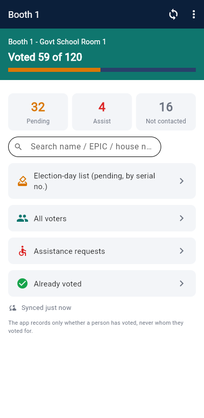
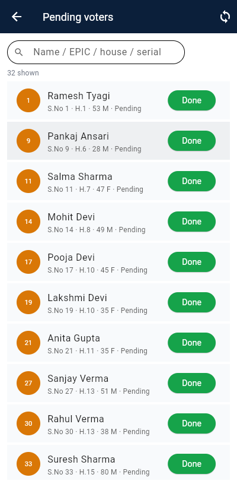
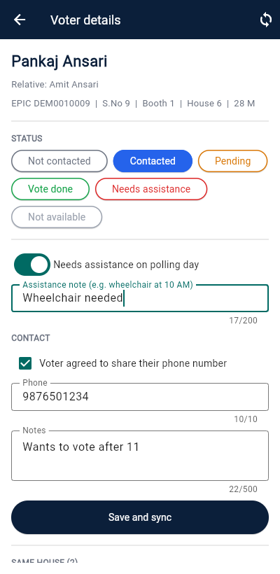
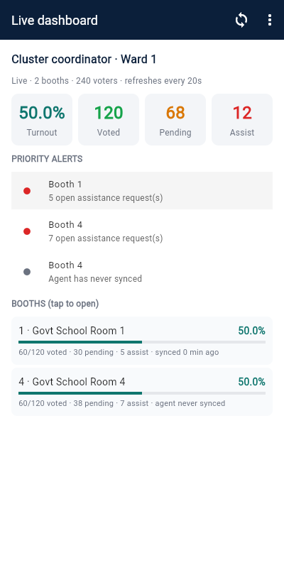
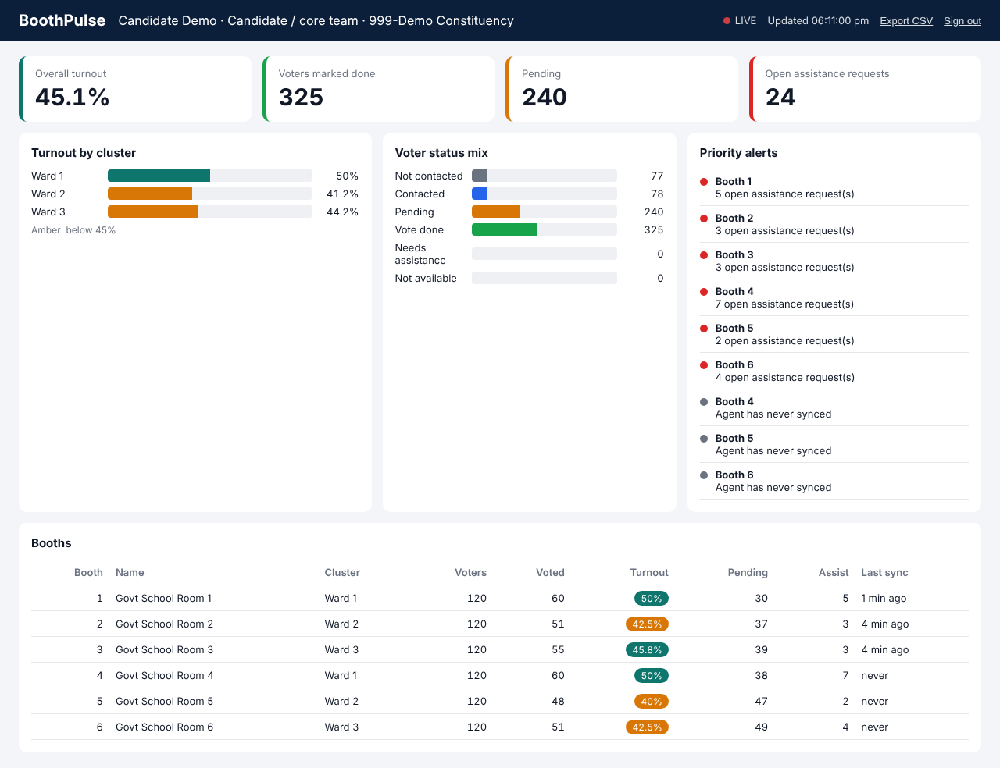

# BoothPulse

Booth management and live election-day tracking for a campaign. It has three parts:

- **Backend.** Django + Django REST Framework. Handles phone/OTP login, roles, server-side booth isolation, electoral roll import, offline sync, the live dashboard API, CSV reports and an audit log.
- **Mobile app.** Python + [Flet](https://flet.dev). One codebase builds an Android APK/AAB and an iOS IPA. The app works offline: everything is saved on the phone first and synced when the network returns.
- **Web dashboard.** For the candidate and the control room, at `/dashboard/`. It refreshes every 15 seconds.

| Agent home | Pending list | Voter detail | Coordinator dashboard |
|---|---|---|---|
|  |  |  |  |



*All screenshots use generated demo data.*

## What it does (MVP)

| Role | Where | Can do |
|---|---|---|
| Booth agent (2 per booth) | Mobile app | See only their own booth. Search by name, EPIC, house or serial number. Mark status. Tap **Done** once a voter has voted. Raise assistance requests. Record a phone number (with consent) and notes. Works offline. |
| Cluster coordinator | Mobile app, web | Live view of the booths in their cluster. Can open any of those booths and edit voters. Booth CSV report. |
| Candidate / core team | Web dashboard, mobile app | Read-only live view of the whole constituency. Voters' phone numbers and notes are hidden from this role. |
| Control room admin | Django admin, web dashboard | Set up the constituency, booths, clusters and users. Import rolls. Monitor everything. |

Voter status values: `not_contacted`, `contacted`, `pending`, `vote_done`, `needs_assistance`, `not_available`.

### Built-in guardrails
- **Turnout only.** The system records *whether* a person has voted, never *whom* they voted for.
- **No incentives and no campaign transport.** There is no feature for these. Both are corrupt practices under Section 123 of the Representation of the People Act, 1951. Assistance requests are meant to be routed to Election Commission facilities (Saksham app, home voting, the 1950 helpline).
- **Booth isolation is enforced on the server.** Every query is scoped to the user's role (`booths/services.py`). An agent cannot open another booth's voter, even by guessing an id.
- **Personal data (DPDP Act 2023).** A phone number is stored only if the consent box is ticked. Every edit is logged with user, time and device (`VoterChange`, `AuditLog`). After the election, `python manage.py purge_personal_data` erases phone numbers, notes and change history.
- **Inclination tagging (supporter/neutral/opposed) is off** until the client signs off a written policy. Set `FEATURE_INCLINATION=1` to enable it.
- Phones may not be used inside a polling station. The intended flow is: the polling agent inside ticks a paper sheet, and the booth agent at the party table (at least 200 m away) enters it in the app.

Have an election lawyer review these rules before going live.

## Run it locally

### 1. Backend

```bash
cd backend
python -m venv .venv && source .venv/bin/activate   # Windows: .venv\Scripts\activate
pip install -r requirements.txt
python manage.py migrate
python manage.py seed_demo --simulate        # demo constituency, 6 booths x 120 fake voters
python manage.py createsuperuser             # for /admin/
OTP_ECHO_IN_RESPONSE=1 python manage.py runserver 0.0.0.0:8000
```

- Web dashboard: http://127.0.0.1:8000/dashboard/
- Control room admin: http://127.0.0.1:8000/admin/

Demo logins (the OTP is printed in the server console, and shown on screen while `OTP_ECHO_IN_RESPONSE=1`):

| Phone | Role |
|---|---|
| 9000000001 | Control room admin |
| 9000000002 | Candidate (read-only) |
| 9000000003 | Coordinator, Ward 1 (booths 1 and 4) |
| 8000010001, 8000010002 | Agents, booth 1 (pattern `8BBBBB000N`) |

### 2. Mobile app (on your computer first)

```bash
cd mobile
pip install "flet[all]>=1.1.3" certifi
flet run                    # desktop window
flet run --android          # live on your phone via the Flet app from the Play Store / App Store
```

On the login screen, open **Server settings** and enter the backend address, for example `http://192.168.1.20:8000` on your Wi-Fi network.

### Demo mode (no server)

On the login screen, tap **Try the demo**: **Booth agent** or **Dashboard**. The app generates 4 booths with 600 sample voters on the phone. Every screen works offline. Sign out to leave demo mode.

### Download the Android APK

Every push to `main` builds the APK on GitHub Actions. You can download it from the repo's **Releases** page (`BoothPulse-demo.apk`).

### 3. Build the phone apps yourself

```bash
cd mobile
flet build apk              # Android APK (build on Windows, macOS or Linux)
flet build aab              # Android App Bundle for Google Play
flet build ipa              # iOS (macOS with Xcode and an Apple developer account)
```

Release builds of Android and iOS apps block plain `http://`. Run the backend behind **HTTPS** (see Deploy), or test over a tunnel such as `cloudflared tunnel --url http://localhost:8000`.

## Import a real electoral roll

Rolls are published as PDFs, often scanned images in Hindi. Convert each booth's roll to a CSV with these columns. The header row is required.

```
part_no,booth_name,serial_no,epic,name,relative_name,house_no,age,gender,booth_address,cluster
```

Then import it either way:

```bash
python manage.py import_roll roll.csv --constituency 1
# or POST multipart `file` to /api/import/roll/ as an admin
```

Re-importing is safe. Voters are matched on `(booth, serial_no)`, and campaign data (status, notes) is kept. Do not commit real rolls to git (`.gitignore` blocks `*.roll.csv` and `rolls/`).

## API

All endpoints are under `/api/`. Authenticate with the header `Authorization: Token <token>`. Phones also send `X-Device-Id`.

| Method | Path | Purpose |
|---|---|---|
| POST | `auth/otp/request/` | `{phone}`. Sends an OTP. Rate-limited per phone number. |
| POST | `auth/otp/verify/` | `{phone, code, device_id}` returns `{token, user}`. A new login signs out the old device. |
| POST | `auth/logout/` | Ends the session. |
| GET | `me/` | Current user, role, booth and feature flags. |
| GET | `booths/` | Booths in the caller's scope. |
| GET | `voters/` | `?booth=&q=&status=a,b&needs_assistance=1&since=<ISO>&limit=&offset=` |
| PATCH | `voters/{id}/` | Changes status, assistance, consent, phone or notes. |
| POST | `sync/` | `{changes:[{event_id, voter_id, client_ts, ...}]}`. Idempotent; each item is reported individually. |
| GET | `dashboard/` | Totals, status mix, clusters, booths and alerts for the caller's scope. |
| GET | `reports/booths.csv` | Booth-wise report (not for agents). Every download is audit-logged. |
| POST | `import/roll/` | Admin only. Roll CSV upload. |

**How sync conflicts are resolved.** The newest change wins, judged by the time it was made on the phone, not the time it reached the server. This is applied separately to the status and to the details. So a phone that was offline for an hour cannot overwrite a newer update. If a phone's clock is set in the future, the server treats its timestamps as "now" so that phone cannot win every conflict.

## Deploy (production)

Set these environment variables:

```
DJANGO_DEBUG=0
DJANGO_SECRET_KEY=<long random string>
DJANGO_ALLOWED_HOSTS=api.example.in
DJANGO_CSRF_TRUSTED_ORIGINS=https://api.example.in
POSTGRES_DB=boothpulse POSTGRES_USER=... POSTGRES_PASSWORD=... POSTGRES_HOST=...
SMS_BACKEND=yourpackage.sms.Msg91Backend     # any class with send(phone, message)
OTP_ECHO_IN_RESPONSE=0
```

Then run:

```bash
python manage.py migrate && python manage.py collectstatic --noinput
gunicorn config.wsgi --workers 4 --bind 0.0.0.0:8000
```

Put it behind Nginx or a load balancer with HTTPS, in an India region (for example AWS Mumbai), with daily database backups. Indian SMS gateways need a DLT-registered sender ID and message template for the OTP SMS.

Before polling day, load-test the sync and dashboard endpoints for your number of agents. Also run a mock poll on a few pilot booths.

## Tests

```bash
cd backend && python manage.py test                       # 23 tests: auth, isolation, sync, import, dashboard
cd mobile && BOOTHPULSE_TEST_SERVER=http://127.0.0.1:8000 pytest   # offline store + sync against a live server
```

## Project layout

```
backend/
  accounts/   User (phone + role), OTP, audit log, SMS backends, throttles
  booths/     Constituency, Cluster, Booth, Voter, VoterChange; scoping, sync, dashboard, roll import
  templates/dashboard.html   live web dashboard
mobile/
  src/main.py                 Flet entry point
  src/boothpulse_app/ui.py    screens
  src/boothpulse_app/store.py offline SQLite store + outbox
  src/boothpulse_app/sync.py  push/pull sync engine
  src/boothpulse_app/api.py   HTTP client (standard library only)
```

## Next (from the plan)
Time slots per voter and no-show alerts; a voter slip PDF in two templates (plain for polling day); the public voter-search website; a booth heat map; WhatsApp/SMS reminders limited to "when and where to vote" in the last 48 hours; Hindi UI.
